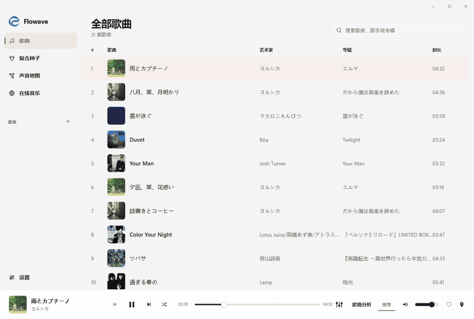
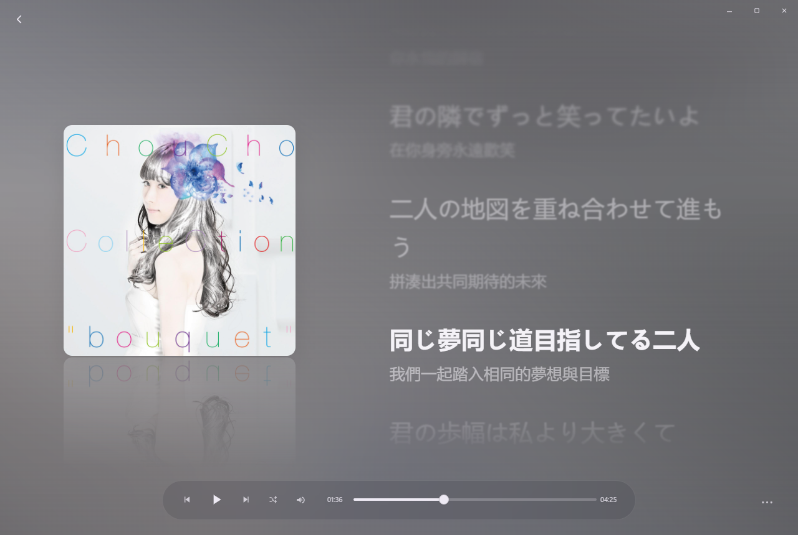
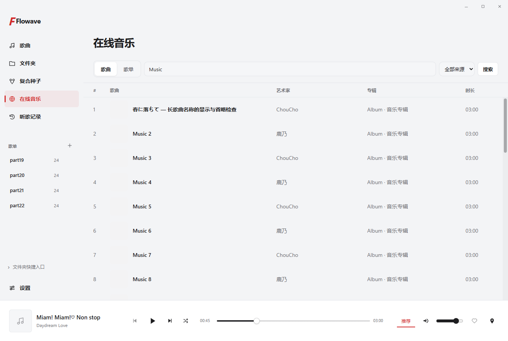
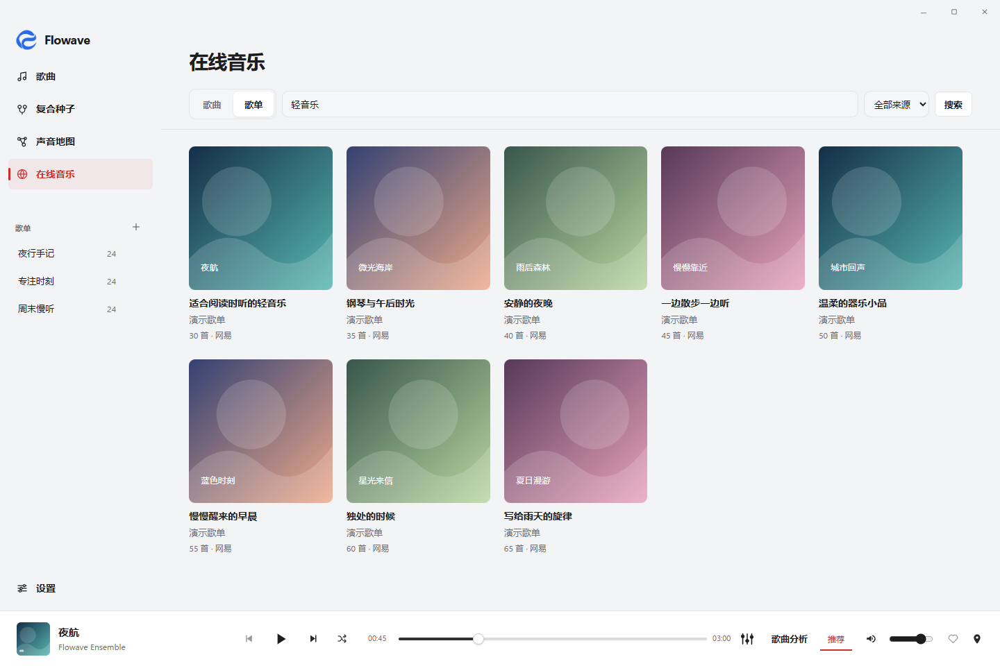
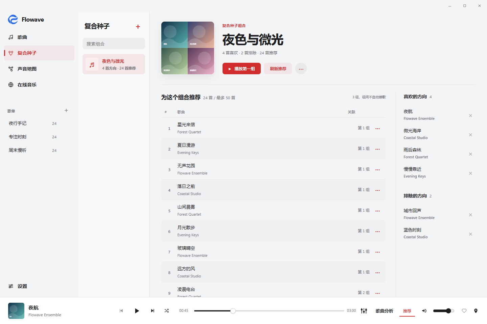
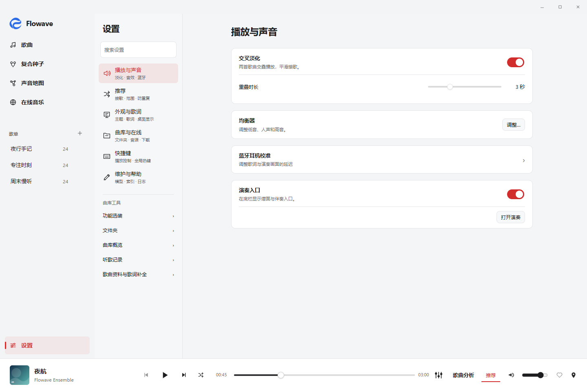

<h1 align="center">Flowave</h1>

一个注重连续听感的 Windows 音乐播放器

## 说明

Flowave 用于沉浸式听音乐，注重歌曲之间风格和听感的连续性。软件根据当前播放、听歌反馈和近期记录判断偏好，推荐下一曲。

可以顺着当前方向继续听，也可以使用“找回感觉”纠偏，或用“换个感觉”切换方向。支持本地曲库、歌单、在线搜索、逐字歌词、桌面歌词、均衡器和交叉淡化。

目前支持 Windows 10/11 x64。

使用方法请查看[使用指南](docs/使用指南.md)，源码运行请查看[源码运行与构建](docs/源码运行与构建.md)。安装包与ZIP便携版通过 [GitHub预发布](https://github.com/nadeshikochan/Flowave/releases/tag/v0.2.1-preview.1) 提供，校验值和实际验收范围随发布说明记录。

### 插件

提供歌曲推荐、歌曲分析、演奏练习、听歌记录四个官方插件。[插件下载](https://github.com/nadeshikochan/Flowave/releases/tag/plugins-v1.1.0)。声音地图与复合种子归入歌曲推荐，分轨与谱面辅助归入演奏练习。

在“设置 → 插件与模型”中点击安装，软件自动获取官方代码包及匹配的模型、运行环境和工具，完全退出重开后启用。代码包可来自固定 GitHub Release 或便携版随附归档，也可从本地导入 fwm；模型独立校验下载。移除插件保留听歌记录、模型、索引和分析成果。当前仓库为私有测试，匿名 GitHub 下载不可用。安装包未签名，两项分轨权重授权仍待确认，具体来源和条款见 [第三方说明](release-template/THIRD_PARTY_NOTICES.txt)。

- 歌曲推荐：根据声音特征和听歌反馈选择下一曲，兼顾当前方向与近期重复情况。
- 听歌记录：查看听歌时长、播放次数和歌曲排行。
- 声音地图：浏览相近歌曲，查看歌曲关系和实际听歌轨迹。
- 歌曲分轨：调整人声和乐器声部，配合循环、变速和节拍器练习。
- 和声检测：提供和弦、调性等分析信息，识别结果需要核对。
- 复合种子：用多首歌曲组合喜欢和排除的方向，生成分组推荐。

### 在线音源

本仓库不包含第三方在线音源脚本，使用在线播放时需自行导入可信来源。仓库中的搜索接口和脚本加载器属于播放器代码。

### 本地数据

软件无需注册账户，配置、历史和分析结果保存在本机。在线搜索、资料查询和组件下载会访问相应服务。详情请查看[隐私与数据](docs/隐私与数据.md)。

## 用户界面

### 歌曲播放

多目录曲库、搜索、歌单和播放队列。以下以ヨルシカ《雨とカプチーノ》1:00处为例，展示从歌曲列表进入歌词页。

[观看 MP4 视频](docs/images/playback.mp4) · [查看 1:00 歌曲页面](docs/images/library.png)

### 歌词

支持逐字歌词、多语言歌词和桌面歌词，可以调整字号、配色与背景。

### 声音地图

查看这首歌附近的音乐，也可以切换全库视图、歌曲比较和听歌轨迹。

以上演示使用当前界面、本地已有歌曲资料及保存的音频向量关系渲染。静态页面停在1:00，播放动画为1:00–1:10的无声演示，不含歌曲音频。

### 在线搜索

可以搜索歌曲和歌单。歌曲搜索沿用原有界面截图；歌单搜索图使用演示数据，不表示仓库内置音源。

### 复合种子

加入喜欢和排除的歌曲，保存组合并查看推荐。推荐分组播放，组间不自动接歌。以下沿用原有演示图。

### 设置

播放、音效、外观、歌词、曲库和快捷键等设置。

## 使用反馈

遇到问题可提交 [Issue](https://github.com/nadeshikochan/Flowave/issues)，说明版本和复现步骤。上传日志前请删除个人路径、凭据等信息。安全问题请查看[安全政策](SECURITY.md)。

## 项目许可

主程序允许个人非商业长期使用，原始代码和资源保留全部权利，具体见 [LICENSE](LICENSE)。源码公开供查阅，修改及再分发需另行取得授权。

第三方组件遵循各自许可。MERT-v1-330M 使用 CC BY-NC 4.0，限制商业用途，模型不随仓库分发。详情见 [THIRD_PARTY_NOTICES.txt](release-template/THIRD_PARTY_NOTICES.txt)。
