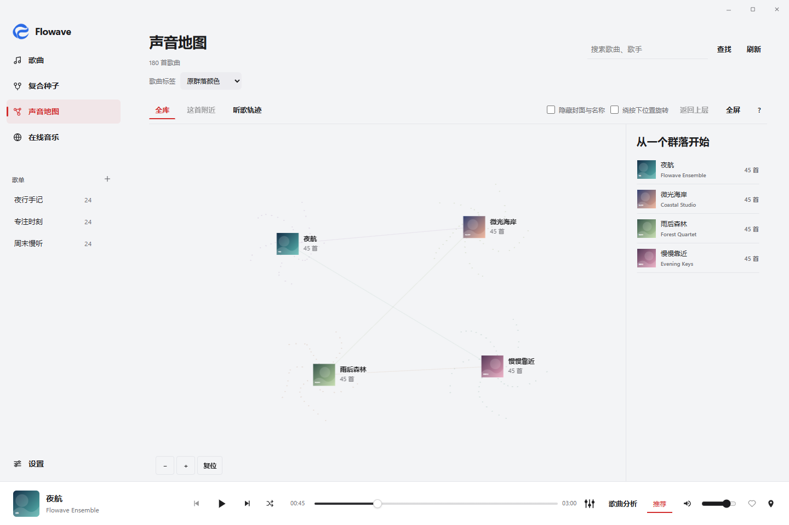
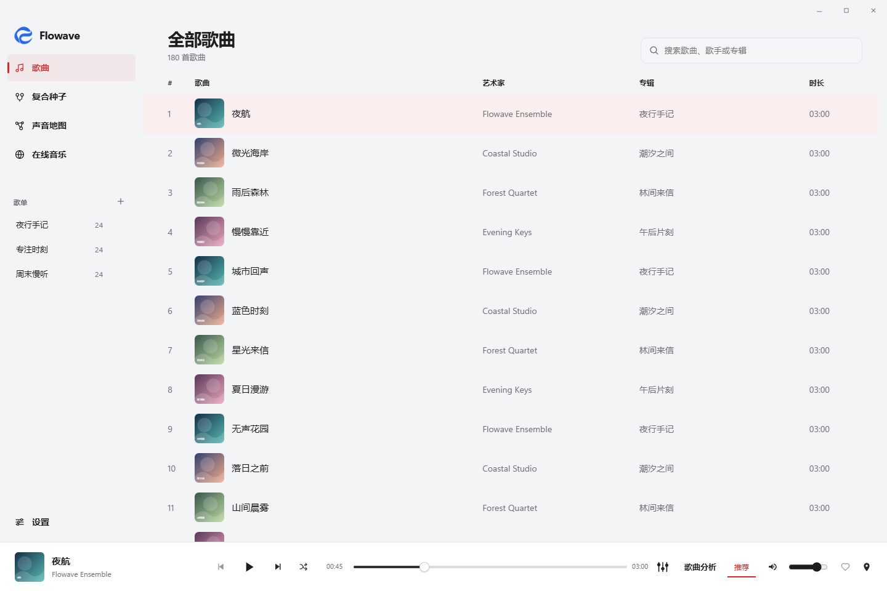
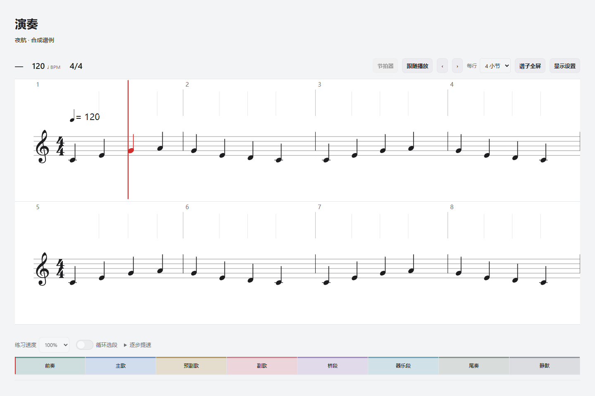
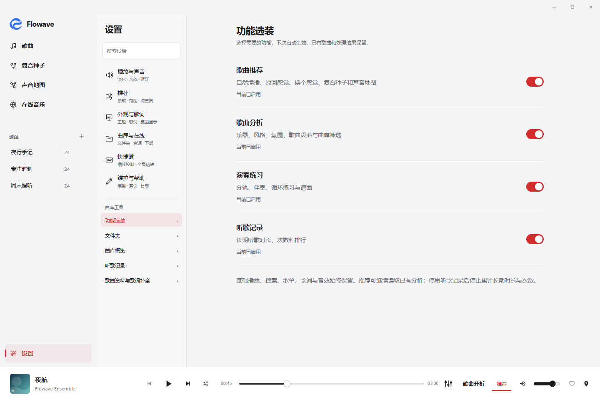

  

# Flowave

Flowave 是一个 Windows 本地音乐播放器。它可以管理和播放电脑里的音乐，也可以从你选的一首歌出发，在自己的曲库里接着找歌。

收藏的歌多了，有时反而不知道该听什么。随机播放容易打断刚刚听进去的感觉，自己挑歌又需要不断回到列表。Flowave 想让这个过程省心一些：合适就继续，走偏了就找回，听够了就换个方向。

如果你习惯保留自己的音乐文件，希望多听到一些已经收藏、却很少点开的歌，Flowave 就是围绕这样的日常使用来做的。曲库、歌词和播放是基础，推荐、歌曲分析和伴奏练习可以按需要开启。

[使用指南](docs/使用指南.md) · [源码运行与构建](docs/源码运行与构建.md) · [Releases](https://github.com/nadeshikochan/Flowave/releases)

目前提供源码预览，安装包尚未发布。下方图片使用当前界面和演示数据，曲目、封面、歌词、推荐关系与谱例均为虚构示例。

## 从喜欢的一首接着听

你可以先选一首现在想听的歌，再交给 Flowave 接着找。推荐会比较歌曲本身的声音特征，也会参考已有的歌曲分析和近期播放情况，无需先给整份曲库手工分类。

听的过程中，可以延续当前方向；遇到不合适的歌，用“找回感觉”往刚才的方向靠拢；想换一换，就用“换个感觉”开始下一段。近期播放和重复控制也会参与选择，减少总在几首歌之间来回的情况。

这里关注的是一段连续的聆听：下一首能不能接得上，同时还能不能慢慢听到别的歌。推荐结果会受曲库和个人听感影响，需要相应模型、运行组件及已经完成的曲库索引。

## 用几首歌说明想听什么

有时一首歌还说不清想听的感觉。复合种子可以把几首喜欢的歌放在一起，也可以加入想避开的方向，保存成一个组合。

比如想保留几首歌共有的氛围，又不想接到另一类声音，就可以同时给出这些例子，再浏览推荐结果。以后想听类似的音乐，可以回到这个组合继续用。

结果按可衔接的组排列，可以选择从哪一组开始。组与组之间不自动接歌，避免把不同方向硬连成一条播放列表。

## 在地图里找歌

当你只记得一首歌的感觉，却说不出它属于什么风格时，也可以从声音地图开始找。

地图把模型中相近的歌曲放到可以浏览的空间里。先看全库，再进入某个群落，或展开一首歌附近的音乐；可以搜索、缩放、平移和旋转，也可以按需查看歌曲关系与相似度矩阵。

听歌轨迹则保留实际经过的歌曲和换向经历，方便回看刚才从哪里听到了哪里。地图的位置是模型关系的投影，适合帮助探索，不能直接当作严格的风格分类。

## 管理自己的音乐收藏

Flowave 支持多个音乐目录，可以按歌曲、歌手或专辑搜索，也可以浏览文件夹、建立歌单和安排播放队列。普通播放按当前列表顺序进行，想随机听或循环播放时也可以切换。

歌曲资料、封面和歌词可以按需查找补全，音频标签也可以编辑。音乐分散在不同文件夹时，不必为了使用播放器先搬到同一个位置；从曲库移除目录也不会删除音频文件。

## 看歌词，安心听歌

歌词页把封面、背景和文字放在同一个画面里。当前歌词突出显示，前后歌词逐渐模糊；有逐字时间信息时，可以跟随音乐高亮，也支持多语言歌词。

想读前后的内容时可以手动浏览，随后恢复跟随。字号、配色和背景效果都可以调整。平时在别的窗口工作，也可以打开桌面歌词，不必一直把播放器放在前面。

日常播放还提供均衡器、交叉淡化、媒体键和全局快捷键。交叉淡化可以调整自然切歌时的重叠时长；蓝牙耳机校准用于调整歌词与演奏画面的延迟，并按输出设备保存补偿。校准包含人的跟拍反应，实际同步效果仍需结合设备确认。

## 跟着歌曲练习

听到想跟唱或练习的一段，可以进入演奏页，准备分轨伴奏，再调整需要保留的人声和乐器声部。

练习时可以选一段反复播放、放慢速度，或使用逐步提速和节拍器。谱面会显示播放位置，支持跟随、分页、全屏和显示设置。歌曲分析提供的段落信息，也方便回到前奏、主歌或副歌继续练。

分轨、旋律识别和自动谱面需要额外模型与运行环境，效果受音源和硬件影响。谱面目前适合作为辅助，需要人工核对，还不能保证达到直接演奏的精度。

## 只开启需要的功能

只想播放音乐时，可以保留基础功能。想继续使用推荐、歌曲分析、演奏或听歌记录，再分别开启；选择在下次启动时生效。

关闭功能会保留已有歌曲和处理结果，不会自动删除模型或用户数据。听歌记录开启时，可以查看长期时长、次数和排行；关闭后停止累计这些统计。基础播放、搜索、歌单、歌词和音效始终保留。

目前尚未提供所有可选模块的独立下载安装包，部分模型功能仍需自行准备环境。

## 使用与下载

支持 Windows 10/11 x64。当前可以按照[源码运行与构建](docs/源码运行与构建.md)准备基础播放环境；安装包和便携版以 [Releases](https://github.com/nadeshikochan/Flowave/releases) 实际发布的文件为准。

应用无需注册账户，配置、历史和分析结果保存在本机。在线资料查询、模型下载以及用户导入的音源脚本会访问相应服务，详见[隐私与数据](docs/隐私与数据.md)。仓库不提供音乐内容或第三方在线音源脚本。

遇到问题可以提交 [Issue](https://github.com/nadeshikochan/Flowave/issues)，附上版本、复现步骤和脱敏日志。安全问题请参阅[安全政策](SECURITY.md)。

## 许可

源码公开供查阅，项目原始代码和资源保留全部权利，具体授权见 [LICENSE](LICENSE)。公开源码不代表授予修改或再分发许可。

第三方组件遵循各自许可。MERT-v1-330M 使用 CC BY-NC 4.0，限制商业用途，模型不随本仓库分发。更多说明见 [THIRD_PARTY_NOTICES.txt](release-template/THIRD_PARTY_NOTICES.txt)。
